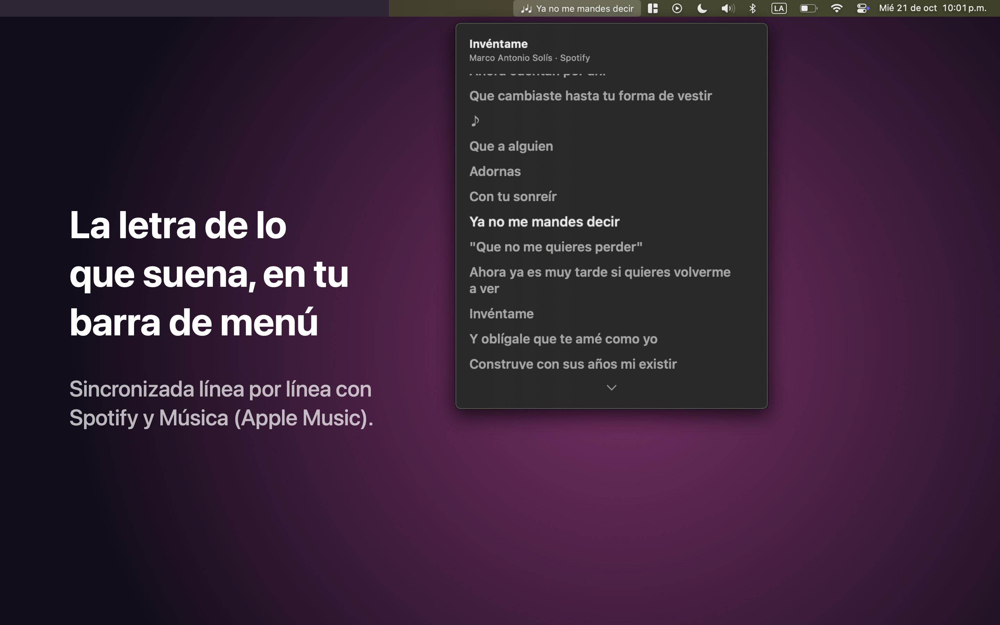
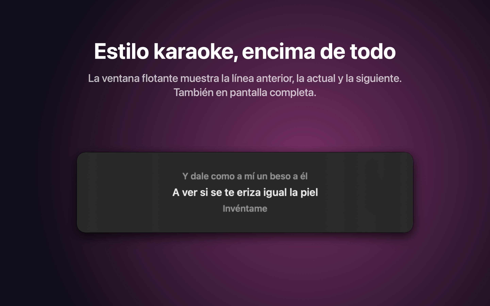
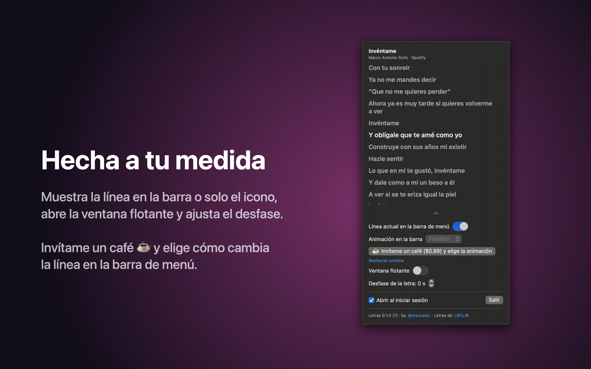
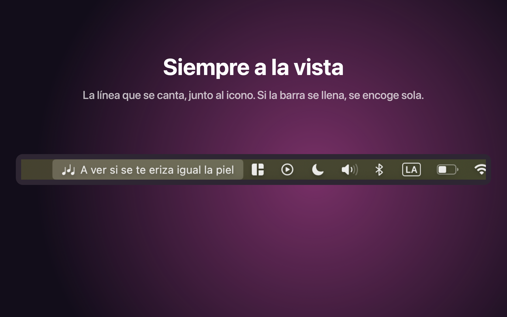

# Letras.app

La letra de la canción que suena en **Spotify** o en **Música** (Apple Music), sincronizada línea por línea, desde la barra de menú de la Mac.

- **En la barra de menú:** la línea que se está cantando, junto al icono. Se puede apagar y dejar solo el icono.
- **En el panel:** la letra completa, con la línea actual resaltada y siempre al centro.
- **Ventana flotante:** la línea anterior, la actual y la siguiente, estilo karaoke, encima de las demás ventanas (también en pantalla completa). Se arrastra a donde quieras; clic derecho para ocultarla.
- **Desfase:** si una letra va atrasada o adelantada, se ajusta en pasos de 0.25 s.
- Las letras vienen de [LRCLIB](https://lrclib.net), una base de datos abierta y gratuita, y se guardan en la Mac: una canción que ya sonó tiene letra aunque no haya internet.

Requiere **macOS 13 (Ventura) o más nuevo**.

| Ventana flotante | Ajustes | Barra de menú |
| --- | --- | --- |
|  |  |  |

## Gratis y con café

Todo lo de arriba es gratis. En la versión de la Mac App Store, **"Invítame un café ☕"** es una compra única que además deja elegir cómo cambia la línea en la barra de menú: deslizar, rodillo, revelado, fundido o sin animación. Sin el café, la barra usa el fundido.

La versión que se descarga de esta página (el DMG) trae todo incluido.

## Permisos

La primera vez que suena algo, macOS pregunta si Letras puede controlar Spotify o Música. Hace falta para saber qué canción suena y en qué segundo va; Letras no cambia nada en el reproductor. Si se negó, se activa en **Ajustes del Sistema > Privacidad y seguridad > Automatización > Letras**.

## Licencia

[MIT](LICENSE). Las letras son de sus autores y vienen de LRCLIB; la licencia solo cubre el código de la app.
