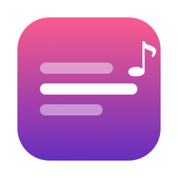
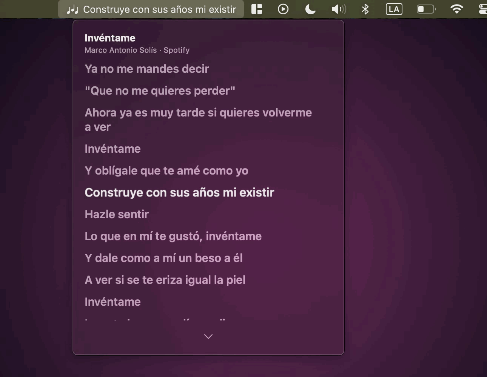

  

<h1 align="center">Letras.app</h1>

  La letra de la canción que suena en <strong>Spotify</strong> o en <strong>Música</strong> (Apple Music), sincronizada línea por línea, desde la barra de menú de la Mac.

  
  <!-- Cuando aprueben la app en la Mac App Store:
  
  -->

  
  
  

  <a href="https://msucedo.github.io/letras/">msucedo.github.io/letras</a>

  

- **En la barra de menú:** la línea que se está cantando, junto al icono. Se puede apagar y dejar solo el icono.
- **En el panel:** la letra completa, con la línea actual resaltada y siempre al centro.
- **Ventana flotante:** la línea anterior, la actual y la siguiente, estilo karaoke, encima de las demás ventanas (también en pantalla completa). Se arrastra a donde quieras; clic derecho para ocultarla.
- **Desfase:** si una letra va atrasada o adelantada, se ajusta en pasos de 0.25 s.
- Las letras vienen de [LRCLIB](https://lrclib.net), una base de datos abierta y gratuita, y se guardan en la Mac: una canción que ya sonó tiene letra aunque no haya internet.

Requiere **macOS 13 (Ventura) o más nuevo**.

| Ventana flotante | Ajustes | Barra de menú |
| --- | --- | --- |
|  |  |  |

## Instalar

1. Descarga el DMG de la [última versión](https://github.com/msucedo/letras/releases/latest) y ábrelo.
2. Arrastra **Letras** a **Aplicaciones** y ábrela. Aparece en la barra de menú.
3. Pon una canción en Spotify o en Música.

La app está firmada y notarizada por Apple, así que abre sin avisos de "desarrollador no identificado".

## Gratis y con café

Todo lo de arriba es gratis. En la versión de la Mac App Store, **"Invítame un café ☕"** es una compra única que además deja elegir cómo cambia la línea en la barra de menú: deslizar, rodillo, revelado, fundido o sin animación. Sin el café, la barra usa el fundido.

La versión que se descarga de esta página (el DMG) trae todo incluido.

## Permisos

La primera vez que suena algo, macOS pregunta si Letras puede controlar Spotify o Música. Hace falta para saber qué canción suena y en qué segundo va; Letras no cambia nada en el reproductor. Si se negó, se activa en **Ajustes del Sistema > Privacidad y seguridad > Automatización > Letras**.

## Privacidad

Sin cuentas, sin analíticas, sin publicidad y sin rastreo. Para buscar la letra solo se envían el título, el artista, el álbum y la duración a LRCLIB. Detalles en [PRIVACY.md](PRIVACY.md).

## Licencia

[MIT](LICENSE). Las letras son de sus autores y vienen de LRCLIB; la licencia solo cubre el código de la app.

---

### In English

**Letras** shows time-synced lyrics for whatever is playing in **Spotify** or **Apple Music**, right in your Mac's menu bar: the current line next to the icon, the full lyrics in a panel, or a floating karaoke-style window. Lyrics come from [LRCLIB](https://lrclib.net) and are cached locally. Free, no accounts, no tracking. macOS 13+. [Download the latest DMG](https://github.com/msucedo/letras/releases/latest) (signed and notarized). The interface is in Spanish.
